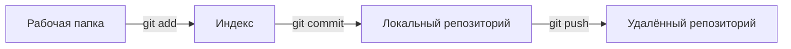
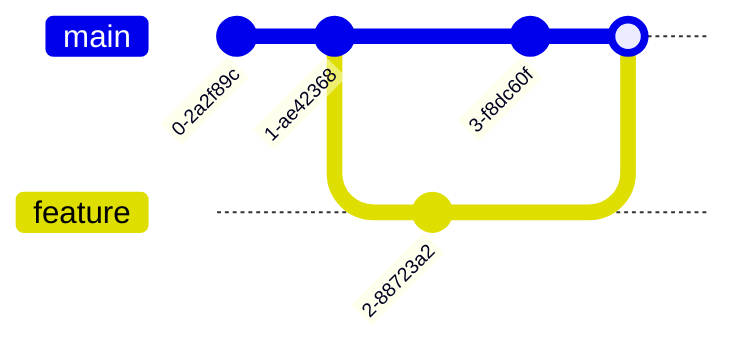

# 01. Теория контроля версий

## Зачем хранить историю

Представим отчёт по продажам, который постоянно меняется: сегодня добавляется фильтр региона, завтра — новая формула расчёта. Если хранить копии файлов с названиями final, final2 и final3, трудно определить, какая версия рабочая. Git сохраняет последовательность изменений с описаниями и позволяет сравнивать состояния проекта.

Git — распределённая система контроля версий: обычный полный клон содержит историю проекта, поэтому коммиты можно создавать без подключения к серверу. GitHub предоставляет удалённое хранение, доступ для команды, обсуждение изменений и автоматические проверки.

## Три области локального Git

Рабочая папка содержит редактируемые файлы. Индекс содержит снимок того, что войдёт в следующий коммит. Локальный репозиторий содержит сохранённые коммиты. Удалённый репозиторий — отдельное хранилище, с которым происходит синхронизация.

Например, изменены report.js и notes.md, но готов только report.js. Команда `git add report.js` позволяет включить в коммит только готовый файл.

## Состояния и сравнение

| Состояние | Значение |
| --- | --- |
| Untracked | Новый файл ещё не отслеживается |
| Modified | Отслеживаемый файл изменён |
| Staged | Изменения подготовлены к коммиту |
| Clean | Нет незакоммиченных изменений |

`git diff` сравнивает рабочую папку с индексом, а `git diff --staged` — индекс с последним коммитом.

## Коммиты и ветки

Коммит хранит ссылку на снимок проекта, родительские коммиты и метаданные. SHA — идентификатор объекта Git. Ветка — перемещаемая ссылка на коммит, а HEAD обычно указывает на текущую ветку.

Ветка помогает разрабатывать функциональность отдельно. Merge объединяет истории; в простом случае возможна перемотка указателя ветки вперёд (fast-forward). Pull request — механизм GitHub для обсуждения и проверки изменений перед объединением.

## Ограничения

Git не заменяет резервное копирование базы данных, не проверяет правильность бизнес-логики и не обеспечивает автоматически защиту секретов. Большие бинарные файлы могут существенно увеличивать размер истории. Для корпоративных данных необходимы отдельные правила хранения и доступа.

## Самопроверка

1. Почему git add не равен git commit?
2. Можно ли создать коммит без интернета?
3. Чем ветка отличается от отдельной копии папки?
4. Почему история Git не заменяет резервную копию базы данных?
