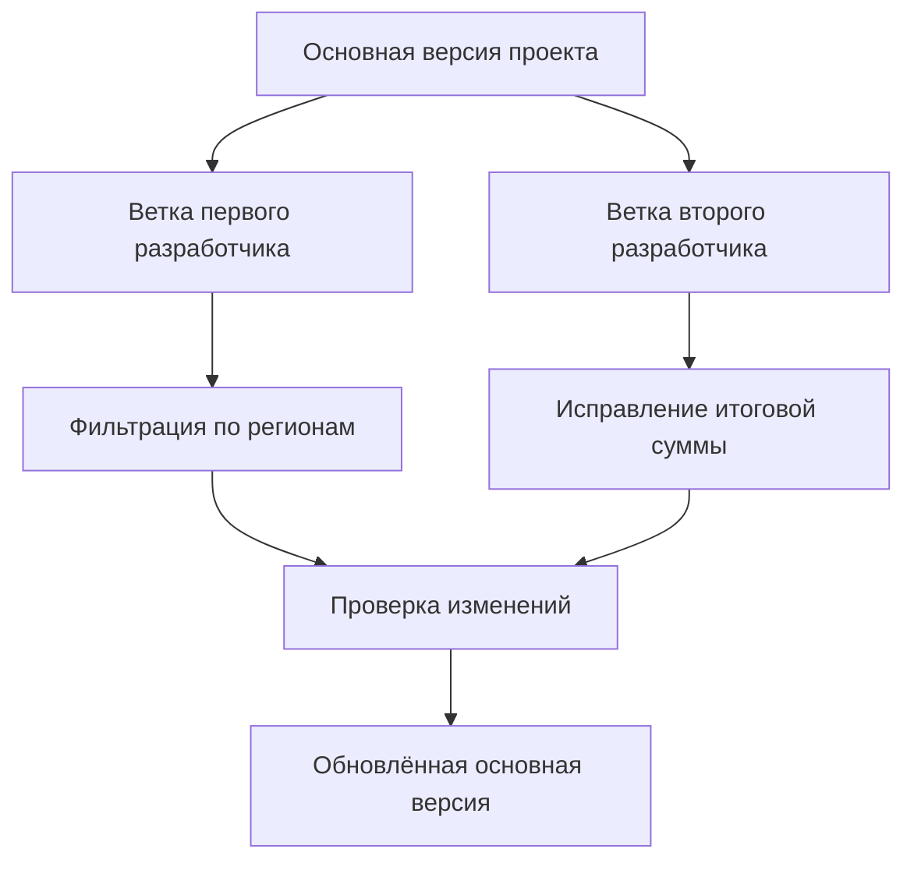

# 03. Как разработчики работают над одним проектом

## 1. Зачем нужен общий порядок работы?

Представим, что компания разрабатывает приложение для анализа продаж. В нём есть таблица с регионами и суммами продаж.

Два разработчика получили разные задачи:

- Первый добавляет возможность фильтровать таблицу по регионам.
- Второй исправляет формулу расчёта итоговой суммы.

Если оба будут одновременно менять одни и те же файлы без согласования, часть изменений может потеряться. Git помогает организовать работу так, чтобы каждый занимался своей задачей отдельно, а готовые изменения можно было проверить и объединить.

## 2. Что такое ветка (Branch)?

Основная ветка проекта обычно называется main. Она содержит общую версию программы.

Для новой задачи разработчик создаёт отдельную ветку. Это похоже на отдельный черновик документа: можно редактировать его, не меняя основной вариант.

В действительности Git хранит ветки как ссылки на сохранённые версии проекта, а не как отдельные копии всех файлов.



Пока изменения не объединены с основной веткой, работа над ними не меняет main.

## 3. Как сохраняется результат (Commit)?

Коммит — это сохранённая версия изменений с коротким описанием того, что было сделано.

Например, первый разработчик закончил фильтр по регионам и создал коммит с описанием «Добавлен фильтр по регионам».

Благодаря этому команда может посмотреть, какие файлы изменились, кто внёс изменения и зачем. Лучше сохранять одну законченную небольшую задачу в одном коммите, чем смешивать несколько несвязанных исправлений.

## 4. Как изменения попадают на GitHub?

Работая на своём компьютере, разработчик создаёт локальные коммиты. Чтобы коллеги могли их увидеть, он отправляет их в общий репозиторий на GitHub.

Это действие называется push.

Обратное направление — получение обновлений проекта. Например, коллега уже исправил расчёт суммы, и первому разработчику нужно получить новую версию.

| Термин | Простое объяснение |
| --- | --- |
| Push | Отправить сохранённые изменения на GitHub |
| Fetch | Получить новые коммиты с GitHub, не меняя текущую рабочую ветку |
| Pull | Получить и объединить обновления с текущей веткой |

## 5. Кто проверяет работу (Pull Request)?

Когда фильтр готов, разработчик открывает на GitHub Pull Request — предложение добавить свои изменения в основную ветку проекта.

Коллеги могут посмотреть изменённые строки, оставить замечания и проверить работу программы.

Для нашего примера важно выяснить:

- Правильно ли выбираются регионы?
- Пересчитывается ли итоговая сумма после фильтрации?
- Что происходит, если данных нет?

Если обнаружена ошибка, автор исправляет её в своей ветке и отправляет новые коммиты. Они появляются в том же Pull Request.

После проверки изменения можно объединить с основной веткой. Это называется merge.

## 6. Что делать, если изменения мешают друг другу?

Иногда два разработчика меняют одну строку программы по-разному. Git не всегда может самостоятельно определить, какую версию нужно сохранить. Такая ситуация называется конфликтом слияния (merge conflict).

Допустим, первоначальная формула была:

```text
Итог = Выручка
```

Первый разработчик предлагает вычитать скидки, а второй — возвраты.

Нельзя автоматически считать одну версию правильной только потому, что она появилась позже. Команда должна уточнить правила расчёта. Если по условиям задачи нужно учитывать оба вычета, итоговая формула будет:

```text
Итог = Выручка - Скидки - Возвраты
```

При выручке 100, скидках 5 и возвратах 10 ожидаемый итог равен 85.

После исправления конфликтующих строк разработчик проверяет расчёт и сохраняет результат.

## 7. Можно ли исправить ошибку после публикации?

Да. Если опубликованное изменение оказалось неправильным, Git позволяет создать новый коммит, отменяющий его действие. Такая операция называется revert.

Например, новый фильтр нарушил работу отчёта. Команда может согласовать отмену проблемного изменения и восстановить прежнее поведение, сохранив историю разработки.

Важно: отмена изменения кода не заменяет восстановление данных или откат развёрнутого приложения.

## 8. Практика: команды для разработчика

Этот раздел можно читать после знакомства с основными понятиями. Команды выполняются в отдельном учебном репозитории, уже скопированном с GitHub.

### Шаг 1. Получить актуальную версию

```bash
git switch main
git pull --ff-only
```

Первая команда переключает на основную ветку, вторая получает обновления. Если простое обновление невозможно, Git остановится и сообщит об этом.

### Шаг 2. Создать ветку для задачи

```bash
git switch -c feature/report-filter
```

Теперь можно создать или изменить файл report.md в редакторе, не меняя основную ветку.

### Шаг 3. Проверить и сохранить изменения

```bash
git status
git diff
git add report.md
git diff --staged
git commit -m "Add region filter description"
```

status показывает состояние файлов, diff — изменения отслеживаемых файлов, add подготавливает файл к сохранению. diff --staged показывает то, что войдёт в коммит, включая новый файл. commit сохраняет подготовленные изменения.

### Шаг 4. Отправить работу на GitHub

```bash
git push -u origin feature/report-filter
```

После отправки ветки можно открыть Pull Request на сайте GitHub. Флаг -u связывает локальную ветку с соответствующей удалённой веткой.

### Если возникла проблема

| Проблема | Что делать |
| --- | --- |
| Подготовлен лишний файл | git restore --staged FILE убирает его изменения из индекса, оставляя их в рабочей папке |
| Ошибка уже опубликована | После согласования использовать git revert SHA |
| Возник конфликт при слиянии | Уточнить правильный вариант, исправить файл, выполнить git add и завершить слияние коммитом |
| Нужно отменить незавершённое конфликтное слияние | git merge --abort; начинать слияние лучше с чистой рабочей папкой |
| Не получается отправить изменения | Проверить доступ, название ветки и обновления на сервере |

Не следует принудительно перезаписывать историю общей ветки без согласования с командой.

## 9. Главное, что нужно запомнить

Git помогает каждому разработчику работать над своей задачей отдельно, сохранять историю, получать обновления и объединять проверенные изменения.

GitHub делает этот процесс удобным для всей команды: здесь можно посмотреть изменения, обсудить их и проверить готовность к объединению.

Пример аналитической таблицы является учебным. Для самостоятельной тренировки предназначен раздел [Практические задания](05_Practice.md).
