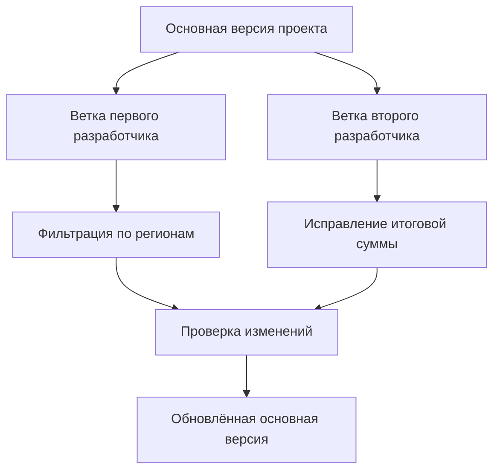
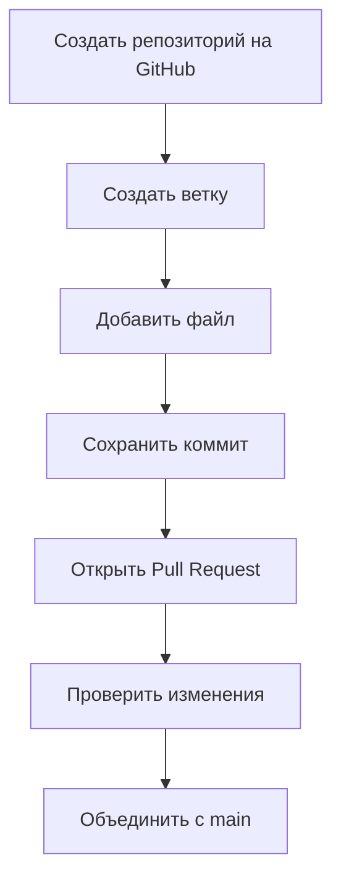

# 03. Как разработчики работают над одним проектом

## 1. Зачем нужен общий порядок работы?

Представим, что компания разрабатывает приложение для анализа продаж. В нём есть таблица с регионами и суммами продаж.

Два разработчика получили разные задачи:

- Первый добавляет возможность фильтровать таблицу по регионам.
- Второй исправляет формулу расчёта итоговой суммы.

Если оба будут одновременно менять одни и те же файлы без согласования, часть изменений может потеряться. Git помогает организовать работу так, чтобы каждый занимался своей задачей отдельно, а готовые изменения можно было проверить и объединить.

## 2. Что такое ветка (Branch)?

Основная ветка проекта обычно называется main. Она содержит общую версию программы.

Для новой задачи разработчик создаёт отдельную ветку. Это похоже на отдельный черновик документа: можно редактировать его, не меняя основной вариант.

В действительности Git хранит ветки как ссылки на сохранённые версии проекта, а не как отдельные копии всех файлов.



Пока изменения не объединены с основной веткой, работа над ними не меняет main.

## 3. Как сохраняется результат (Commit)?

Коммит — это сохранённая версия изменений с коротким описанием того, что было сделано.

Например, первый разработчик закончил фильтр по регионам и создал коммит с описанием «Добавлен фильтр по регионам».

Благодаря этому команда может посмотреть, какие файлы изменились, кто внёс изменения и зачем. Лучше сохранять одну законченную небольшую задачу в одном коммите, чем смешивать несколько несвязанных исправлений.

## 4. Как изменения попадают на GitHub?

Работая на своём компьютере, разработчик создаёт локальные коммиты. Чтобы коллеги могли их увидеть, он отправляет их в общий репозиторий на GitHub.

Это действие называется push.

Обратное направление — получение обновлений проекта. Например, коллега уже исправил расчёт суммы, и первому разработчику нужно получить новую версию.

| Термин | Простое объяснение |
| --- | --- |
| Push | Отправить сохранённые изменения на GitHub |
| Fetch | Получить новые коммиты с GitHub, не меняя текущую рабочую ветку |
| Pull | Получить и объединить обновления с текущей веткой |

## 5. Кто проверяет работу (Pull Request)?

Когда фильтр готов, разработчик открывает на GitHub Pull Request — предложение добавить свои изменения в основную ветку проекта.

Коллеги могут посмотреть изменённые строки, оставить замечания и проверить работу программы.

Для нашего примера важно выяснить:

- Правильно ли выбираются регионы?
- Пересчитывается ли итоговая сумма после фильтрации?
- Что происходит, если данных нет?

Если обнаружена ошибка, автор исправляет её в своей ветке и отправляет новые коммиты. Они появляются в том же Pull Request.

После проверки изменения можно объединить с основной веткой. Это называется merge.

## 6. Что делать, если изменения мешают друг другу?

Иногда два разработчика меняют одну строку программы по-разному. Git не всегда может самостоятельно определить, какую версию нужно сохранить. Такая ситуация называется конфликтом слияния (merge conflict).

Допустим, первоначальная формула была:

```text
Итог = Выручка
```

Первый разработчик предлагает вычитать скидки, а второй — возвраты.

Нельзя автоматически считать одну версию правильной только потому, что она появилась позже. Команда должна уточнить правила расчёта. Если по условиям задачи нужно учитывать оба вычета, итоговая формула будет:

```text
Итог = Выручка - Скидки - Возвраты
```

При выручке 100, скидках 5 и возвратах 10 ожидаемый итог равен 85.

После исправления конфликтующих строк разработчик проверяет расчёт и сохраняет результат.

## 7. Можно ли исправить ошибку после публикации?

Да. Если опубликованное изменение оказалось неправильным, Git позволяет создать новый коммит, отменяющий его действие. Такая операция называется revert.

Например, новый фильтр нарушил работу отчёта. Команда может согласовать отмену проблемного изменения и восстановить прежнее поведение, сохранив историю разработки.

Важно: отмена изменения кода не заменяет восстановление данных или откат развёрнутого приложения.

## 8. Практика: работа прямо на сайте GitHub

Для знакомства с GitHub необязательно устанавливать Git или открывать консоль. Создадим отдельный учебный проект в браузере.

### Шаг 1. Создать репозиторий

1. Войдите в свой аккаунт на [GitHub](https://github.com/).
2. Нажмите значок + в верхней части страницы и выберите New repository. Можно сразу открыть [форму создания](https://github.com/new).
3. В поле Repository name напишите git-training.
4. В Description можно написать «Учебный проект для работы с отчётами».
5. Выберите Private — закрытый репозиторий. Public означает, что файлы доступны всем.
6. Включите Add README. Это создаст первый файл с описанием проекта и начальный коммит.
7. Нажмите Create repository.

Теперь проект существует на GitHub. README.md — его главная страница с описанием. Для доступа к закрытому проекту другого человека нужно пригласить через настройки репозитория.

### Шаг 2. Создать отдельную ветку

На странице проекта откройте список веток (обычно там указано main), выберите View all branches, затем New branch. Укажите имя feature/report-filter и выберите main как исходную ветку. Создайте ветку и переключитесь на неё.

Это наш отдельный черновик: основная версия пока не меняется.

### Шаг 3. Добавить файл и сохранить работу

1. В выбранной ветке нажмите Add file → Create new file.
2. Введите имя report.md.
3. В редакторе напишите:

```text
# Отчёт по продажам
Добавление фильтра по регионам.
```

4. Нажмите Commit changes, укажите описание «Добавлено описание фильтра» и подтвердите сохранение в выбранной ветке.

GitHub сам сохранит коммит. Отдельно выполнять git add или git push не нужно: работа уже находится на сайте.

Чтобы создать папку, можно указать путь к новому файлу, например reports/report.md.

### Шаг 4. Предложить объединение изменений

Откройте вкладку Pull requests, нажмите New pull request и выберите base: main (куда добавляем изменения) и compare: feature/report-filter (откуда берём изменения). Проверьте разницу файлов и нажмите Create pull request. Укажите цель изменения и создайте запрос.

### Шаг 5. Проверить и объединить

Во вкладке Files changed можно посмотреть добавленный текст. Если всё правильно и у вас есть необходимые права, нажмите Merge pull request и подтвердите объединение. Вернитесь в main: файл report.md должен появиться там.



### Когда всё-таки нужен терминал?

Для небольших текстовых инструкций браузера достаточно. При разработке больших программ удобнее скачать проект на компьютер, редактировать код в VS Code и запускать тесты локально. Команды Git для этого разбираются в [настройке окружения](02_Setup.md) и [практических заданиях](05_Practice.md).

Официальные инструкции с иллюстрациями: [создание репозитория](https://docs.github.com/en/repositories/creating-and-managing-repositories/creating-a-new-repository), [первые изменения](https://docs.github.com/en/repositories/creating-and-managing-repositories/quickstart-for-repositories?tool=webui).

## 9. Главное, что нужно запомнить

Git помогает каждому разработчику работать над своей задачей отдельно, сохранять историю, получать обновления и объединять проверенные изменения.

GitHub делает этот процесс удобным для всей команды: здесь можно посмотреть изменения, обсудить их и проверить готовность к объединению.

Пример аналитической таблицы является учебным. Для самостоятельной тренировки предназначен раздел [Практические задания](05_Practice.md).
