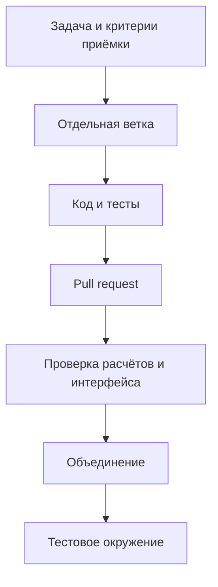

# 04. Git в корпоративном OLAP-проекте

OLAP — подход к многомерному анализу данных. Пример: продажи можно рассматривать по региону, товару и месяцу. Ниже рассматривается условная система, а не фактическое устройство конкретного проекта.

## Что хранится в репозитории

| Компонент | Пример |
| --- | --- |
| Интерфейс | Код таблиц, фильтров и графиков |
| Сервер | Обработка запросов и вычислений |
| Контракты | Описание форматов запросов и ответов |
| Тесты | Проверка расчётов и поведения интерфейса |
| Документация | Инструкции установки и эксплуатации |

Сами корпоративные выгрузки, рабочие пароли и ключи доступа обычно не должны храниться в Git. Для тестов используются синтетические или разрешённые обезличенные данные.

## Пример задачи

Пользователь хочет фильтровать отчёт по региону. Разработчик уточняет требования: должен ли итог пересчитываться после фильтрации? Что показывать при пустой выборке?

Если изменился формат данных между сервером и браузером, важно проверить обе стороны. История Git позволяет связать изменение интерфейса и контракта с одной задачей.

## Проверки до объединения

- Корректность итогов после фильтрации.
- Поведение при пустом наборе данных.
- Обработка ошибки сервера.
- Отсутствие конфиденциальной информации в логах и тестовых файлах.
- Совместимость клиента и сервера.

CI (непрерывная интеграция) может автоматически выполнять тесты при изменении кода. Однако наличие GitHub само по себе не означает, что CI настроен.

## Вопросы кандидату на должность Full-stack разработчика

| Вопрос | Что ожидается в ответе |
| --- | --- |
| Зачем нужна отдельная ветка? | Изолировать задачу до проверки |
| Как проверить изменения коллеги? | Pull request, diff, тесты |
| Как отменить ошибочный опубликованный коммит? | Согласованное исправление через revert |
| Как хранить секреты? | Вне Git, через защищённую конфигурацию |
| Что делать при конфликте формул? | Уточнить требования и проверить результат |

Git — часть процесса разработки, а не механизм анализа данных. Его ценность состоит в управляемой истории, проверяемости изменений и взаимодействии команды.
