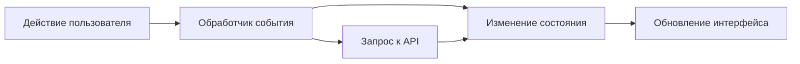

# 01. Что такое JavaScript

JavaScript — язык общего назначения, стандартизованный как ECMAScript. Браузеры используют его для поведения страниц, а Node.js предоставляет среду выполнения за пределами браузера.

## Язык и окружение

JavaScript определяет синтаксис, типы, функции и операции. Окружение предоставляет дополнительные возможности: браузер предоставляет DOM и события, Node.js — доступ к файловой системе и серверным интерфейсам. DOM не является частью самого языка.

| Компонент | Назначение |
| --- | --- |
| HTML | Структура страницы |
| CSS | Внешний вид |
| JavaScript | Поведение и вычисления |
| Node.js | Выполнение JavaScript вне браузера |
| TypeScript | Статическая проверка типов поверх JavaScript |

## Как работает интерфейс

Например, при выборе региона программа может отправить запрос на сервер, получить отчёт и обновить таблицу. Перезагрузка всей страницы не обязательна.

## Особенности языка

JavaScript динамически типизирован: тип относится к значению, а не закрепляется за переменной. Функции можно передавать как аргументы. Объекты и массивы позволяют представлять данные. Асинхронные операции помогают обрабатывать результаты сетевых запросов без блокирования интерфейса ожиданием ответа.

При этом длительные синхронные вычисления в основном потоке браузера могут сделать интерфейс неотзывчивым. Для тяжёлых задач используют серверную обработку, иногда Web Workers.

## Что важно для разработки

Знание синтаксиса само по себе недостаточно: необходимо понимать обработку ошибок, взаимодействие с API, тестирование и безопасность данных. JavaScript на клиенте не должен быть единственным местом проверки прав доступа — сервер обязан проверять их самостоятельно.

## Вопросы

1. Чем Node.js отличается от JavaScript?
2. Для чего нужен DOM?
3. Почему тяжёлый расчёт может заморозить страницу?
4. Почему сервер должен проверять права доступа?
