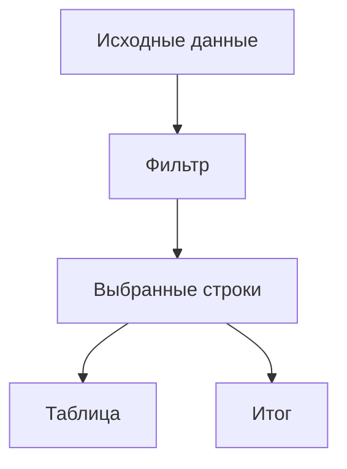

# 04. DOM и события

DOM — объектное представление HTML-страницы. JavaScript может находить элементы, изменять их содержимое и подписываться на события.

```html
<button id="show">Показать итог</button>
<p id="result"></p>
<script>
  document.querySelector("#show").addEventListener("click", () => {
    document.querySelector("#result").textContent = "Итого: 260000";
  });
</script>
```

querySelector находит первый подходящий элемент, addEventListener регистрирует функцию, textContent меняет текст. Для данных пользователя предпочтительно вставлять текст через textContent, а не формировать HTML из непроверенных строк.

## Состояние и отображение

Для отчёта полезно разделить исходные строки, выбранный фильтр и отображение результата. При изменении фильтра рассчитывается новая выборка, затем обновляются таблица и итог.



В [готовом примере](examples/report.html) можно фильтровать продажи по региону и минимальной сумме. Пустая выборка показывает нулевой итог. Данные не изменяются при фильтрации.

## Проверка интерфейса

- Начальное состояние: три строки, итог 260000.
- Минимальная сумма 80000: две строки, итог 200000.
- Регион Сочи: одна строка, итог 60000 при нулевом пороге.
- Порог 200000: пустой результат.
- Некорректный ввод: сообщение вместо расчёта.

В больших проектах Vue помогает связывать состояние и интерфейс декларативно. Здесь используется обычный JavaScript, чтобы сначала понять базовый механизм.
