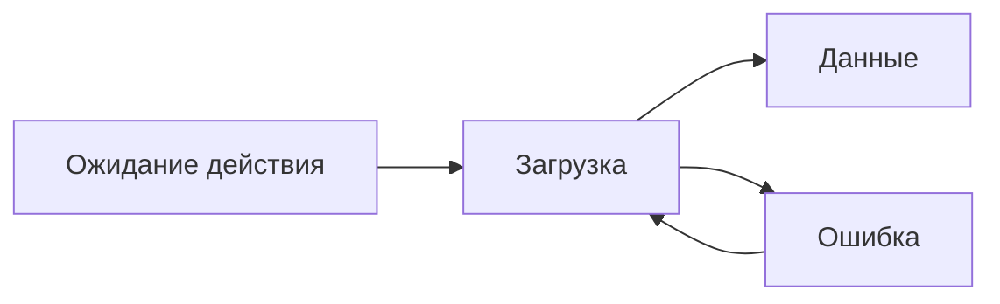

# 05. Асинхронность и API

## Почему программе приходится ждать?

Представим, что руководитель заказал отчёт по продажам за год. Серверу требуется несколько секунд для расчёта. Интерфейс должен показать «Загрузка», а не зависнуть до получения ответа.

Это похоже на заказ в кафе: посетитель получает номер заказа и может заниматься другими делами, пока его готовят. Когда результат готов, программа продолжает работу.

| Термин | Простое объяснение |
| --- | --- |
| API | Правила, по которым одна программа обращается к другой |
| HTTP | Правила передачи запросов и ответов по сети |
| Promise | Объект, представляющий будущий результат операции |
| async | Обозначение функции, возвращающей Promise |
| await | Ожидание результата внутри такой функции |
| fetch | Средство отправить запрос и получить ответ |
| JSON | Текстовый формат передачи структурированных данных |
| try / catch | Попытка выполнить код и обработка возможной ошибки |

Например, сервер может вернуть JSON: {"total":200000}. Это означает, что итог отчёта равен 200000. Если ответ не получен, нужно показать ошибку, а не выдавать старые данные за новые.

Следующие примеры предназначены для изучения кода. Раздел Event loop — дополнительная техническая часть, которую можно пропустить при первом чтении.

Запрос к серверу занимает время. Promise представляет будущий результат операции: ожидание, успешное завершение или отклонение. async-функция возвращает Promise; await приостанавливает продолжение этой функции до результата, но не блокирует весь поток ожиданием сети.

```js
async function loadReport() {
  const response = await fetch("/api/report");
  if (!response.ok) {
    throw new Error("HTTP " + response.status);
  }
  return await response.json();
}
```

fetch может успешно вернуть HTTP-ответ с ошибкой 404 или 500, поэтому нужно проверить response.ok отдельно. Сетевой сбой может отклонить Promise.

```js
async function showReport() {
  try {
    const report = await loadReport();
    console.log(report);
  } catch (error) {
    console.error("Не удалось получить отчёт:", error.message);
  }
}
```

## Состояния интерфейса



Интерфейс должен показывать загрузку, корректно обрабатывать пустой ответ и предоставлять понятное сообщение при ошибке. При быстрых изменениях фильтра ответы могут прийти не по порядку: старый запрос не должен перезаписывать новый результат. Для этого используют идентификаторы запросов или AbortController.

## Event loop

```js
console.log("A");
setTimeout(() => console.log("B"), 0);
Promise.resolve().then(() => console.log("C"));
console.log("D");
```

Ожидаемый порядок: A, D, C, B. Синхронный код завершается первым, затем выполняется микрозадача Promise, после неё — задача таймера. Нулевая задержка не означает немедленное выполнение.

## Локальная демонстрация

Запустите node examples/server.mjs из папки курса. Откройте http://127.0.0.1:3000/api/report?min=80000. Ожидается JSON с двумя строками и итогом 200000. При min=abc сервер возвращает 400.

Это учебный HTTP API без аутентификации, доступный только на loopback-адресе. Он не предназначен для промышленного развёртывания.
