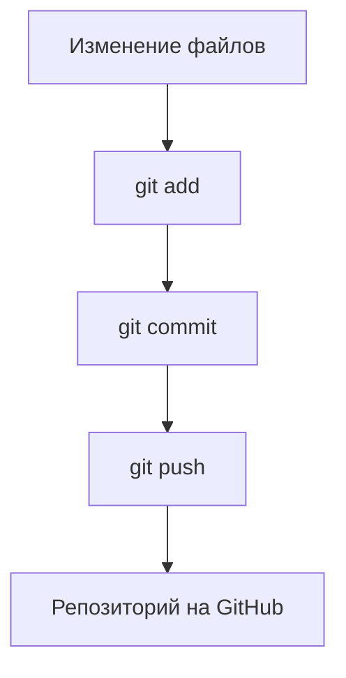

# 01. Git и GitHub

## 1. Что такое Git?

Git — система контроля версий. Она позволяет сохранять историю изменений файлов проекта, сравнивать версии и при необходимости отменять изменения.

Например, разработчик изменил код таблицы в веб-приложении, после чего таблица перестала работать. С помощью Git можно выяснить, какие строки изменились, и восстановить рабочий вариант.

## 2. Что такое GitHub?

GitHub — онлайн-платформа для хранения Git-репозиториев и совместной разработки.

| Git | GitHub |
| --- | --- |
| Инструмент контроля версий | Онлайн-платформа |
| Может работать без интернета | Для работы с онлайн-репозиторием нужен интернет |
| Хранит историю изменений | Позволяет делиться проектом и обсуждать изменения |

Репозиторий — это проект с файлами и историей их изменений.

## 3. Зачем это нужно в OLAP-проекте?

OLAP-приложения предназначены для анализа многомерных данных. При разработке такого приложения Git помогает отдельно отслеживать изменения интерфейса таблиц, серверной логики и механизмов обработки данных.

Если над проектом работают несколько разработчиков, каждый может выполнять свою задачу в отдельной ветке, не изменяя сразу основной код.

## 4. Как происходит работа?



- **Commit** — зафиксированный набор изменений.
- **Branch** — отдельная ветка разработки.
- **Merge** — объединение изменений из разных веток.
- **Pull request** — предложение объединить изменения после их проверки.

## 5. Основные команды

| Команда | Назначение |
| --- | --- |
| `git clone URL` | Копирует репозиторий на компьютер |
| `git status` | Показывает состояние файлов |
| `git diff` | Показывает незаписанные в индекс изменения |
| `git add README.md` | Подготавливает изменения файла к коммиту |
| `git commit -m "Update README"` | Сохраняет подготовленные изменения в истории |
| `git push` | Отправляет локальные коммиты на сервер |
| `git pull` | Получает и интегрирует удалённые изменения |
| `git log --oneline` | Показывает историю коммитов |
| `git switch -c feature/example` | Создаёт новую ветку и переключается на неё |

## 6. Где попробовать?

Git можно установить на компьютер и использовать через терминал или VS Code. Для проверки установки:

```bash
git --version
```

Для простых изменений Markdown-файлов достаточно сайта GitHub: создавать коммиты можно непосредственно в браузере.

## 7. Практический пример

В качестве примера я использую свой учебный репозиторий Fullstack-Engineering-Roadmap.

После установки Git и настройки авторизации можно скопировать репозиторий:

```bash
git clone https://github.com/NBog19/Fullstack-Engineering-Roadmap.git
cd Fullstack-Engineering-Roadmap
git status
git log --oneline
```

Репозиторий приватный, поэтому для клонирования необходим доступ к нему.

Для тренировки можно создать отдельную ветку:

```bash
git switch -c practice/git-basics
```

Создать файл `practice.md` в редакторе, написать в нём небольшой текст, затем выполнить:

```bash
git add practice.md
git commit -m "Practice Git basics"
git push -u origin practice/git-basics
```

После этого ветка появится на GitHub. Через pull request можно предложить объединить её с основной веткой `main`.

Пароли, токены доступа, ключи и конфиденциальные данные нельзя добавлять в репозиторий.

## 8. Что должен уметь разработчик?

- Работать с репозиториями и историей изменений.
- Создавать коммиты с понятными описаниями.
- Работать с ветками и pull request.
- Разрешать конфликты при объединении изменений.
- Не допускать попадания секретов в Git.

## 9. Полезные ресурсы

- [Сайт Git и установка](https://git-scm.com/)
- [Документация GitHub](https://docs.github.com/)
- [Интерактивная тренировка работы с ветками](https://learngitbranching.js.org/)

## Вывод

Git и GitHub помогают организовать разработку, сохранить историю проекта и контролировать изменения. Это базовые инструменты, которые пригодятся мне при изучении следующих технологий Full-stack разработки.
