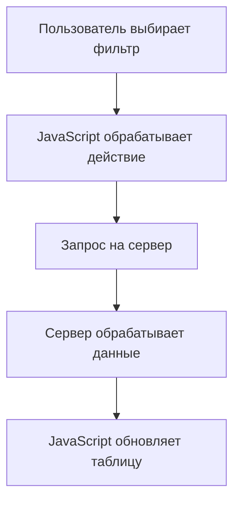

# 02. JavaScript

## 1. Что такое JavaScript?

JavaScript (JS) — язык программирования, который позволяет создавать интерактивные веб-приложения. Он выполняется в браузере, а с помощью среды Node.js — также на сервере.

Например, если пользователь нажимает кнопку, выбирает фильтр или изменяет значение в таблице, JavaScript может обработать это действие и обновить интерфейс без перезагрузки страницы.

## 2. Как JavaScript связан с HTML и CSS?

| Технология | Назначение |
| --- | --- |
| HTML | Структура страницы: кнопки, таблицы, текст |
| CSS | Внешний вид: цвета, размеры, расположение |
| JavaScript | Поведение: действия, вычисления, обработка данных |

## 3. Зачем JavaScript нужен в OLAP-проекте?

В аналитическом приложении JavaScript может отвечать за:

- Обработку действий пользователя.
- Отображение и фильтрацию таблиц.
- Получение данных с сервера.
- Обновление графиков и показателей.
- Отображение сообщений об ошибках.

Большие объёмы данных обычно обрабатываются на сервере, а JavaScript в браузере помогает пользователю взаимодействовать с результатами.



## 4. Основы языка

### Переменные и типы данных

```javascript
const product = "Ноутбук";
let quantity = 3;
const price = 50000;
const available = true;

console.log(quantity * price); // 150000
```

- `const` — переменная, которой нельзя повторно присвоить другое значение.
- `let` — переменная, значение которой можно изменить.
- `string` — строка.
- `number` — число.
- `boolean` — логическое значение: true или false.

### Условия и функции

```javascript
function checkSales(amount) {
    if (amount >= 100000) {
        return "План выполнен";
    }
    return "План не выполнен";
}

console.log(checkSales(120000));
```

Функция — блок кода, который можно использовать несколько раз. Условие if позволяет выбирать действие в зависимости от данных.

### Массивы и объекты

```javascript
const sales = [
    { region: "Москва", amount: 120000 },
    { region: "Казань", amount: 80000 },
    { region: "Сочи", amount: 60000 }
];

const filtered = sales.filter(row => row.amount >= 80000);
const total = sales.reduce((sum, row) => sum + row.amount, 0);

console.log(filtered);
console.log(total); // 260000
```

Массив хранит список элементов, а объект объединяет свойства одного элемента. Метод filter выбирает подходящие записи, reduce позволяет вычислить общий показатель.

## 5. Работа с сервером

Для получения данных из API можно использовать fetch и async/await:

```javascript
async function loadReport() {
    try {
        const response = await fetch("/api/report");

        if (!response.ok) {
            throw new Error("Ошибка загрузки отчёта");
        }

        const report = await response.json();
        console.log(report);
    } catch (error) {
        console.error(error.message);
    }
}
```

API — интерфейс взаимодействия между программами. В этом примере браузер запрашивает отчёт у сервера и обрабатывает полученные данные. Адрес /api/report условный: для запуска примера нужен сервер с таким маршрутом.

## 6. Где писать и запускать JavaScript?

- В консоли браузера: открыть инструменты разработчика и вкладку Console.
- В VS Code: создать файл с расширением .js и запускать его через Node.js командой `node example.js`.
- В онлайн-редакторе, например [JSFiddle](https://jsfiddle.net/).

Для выполнения обычных вычислений в консоли браузера устанавливать дополнительные программы не требуется.

## 7. Практический пример

Для изучения JavaScript можно создать небольшую таблицу продаж. Сохрани этот код в файле sales.html и открой его в браузере.

```html
<!DOCTYPE html>
<html lang="ru">
<head>
    <meta charset="UTF-8">
    <title>Отчёт по продажам</title>
</head>
<body>
    <h1>Продажи по регионам</h1>
    <button id="filter">Показать продажи от 80 000</button>
    <button id="reset">Показать все</button>

    <table border="1">
        <thead>
            <tr><th>Регион</th><th>Продажи</th></tr>
        </thead>
        <tbody id="report"></tbody>
    </table>
    <p id="total"></p>

    <script>
        const sales = [
            { region: "Москва", amount: 120000 },
            { region: "Казань", amount: 80000 },
            { region: "Сочи", amount: 60000 }
        ];

        function render(rows) {
            const table = document.querySelector("#report");
            table.replaceChildren();

            for (const row of rows) {
                const tr = table.insertRow();
                tr.insertCell().textContent = row.region;
                tr.insertCell().textContent = row.amount;
            }

            const total = rows.reduce(
                (sum, row) => sum + row.amount, 0
            );
            document.querySelector("#total").textContent =
                "Итого: " + total.toLocaleString("ru-RU");
        }

        document.querySelector("#filter").addEventListener(
            "click", () => render(sales.filter(row => row.amount >= 80000))
        );

        document.querySelector("#reset").addEventListener(
            "click", () => render(sales)
        );

        render(sales);
    </script>
</body>
</html>
```

При открытии страницы выводятся три региона и сумма 260 000. После нажатия кнопки фильтра остаются Москва и Казань, а сумма меняется на 200 000.

Это упрощённая демонстрация интерактивного аналитического интерфейса, а не полноценная OLAP-система.

## 8. Что должен знать разработчик?

- Переменные, типы данных, условия, циклы и функции.
- Массивы, объекты и методы обработки данных.
- DOM — представление элементов веб-страницы, доступное из JavaScript.
- События: нажатия кнопок и другие действия пользователя.
- Модули, import и export.
- Promise, async/await и обработку ошибок.
- Взаимодействие с сервером через API.

## 9. Полезные ресурсы

- [Учебник JavaScript](https://learn.javascript.ru/)
- [Руководство MDN](https://developer.mozilla.org/ru/docs/Web/JavaScript/Guide)
- [Node.js](https://nodejs.org/)

## Вывод

JavaScript — основа интерактивной веб-разработки. Изучение этого языка поможет мне перейти к TypeScript, а затем к разработке интерфейсов на Vue.
